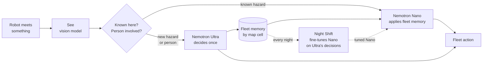
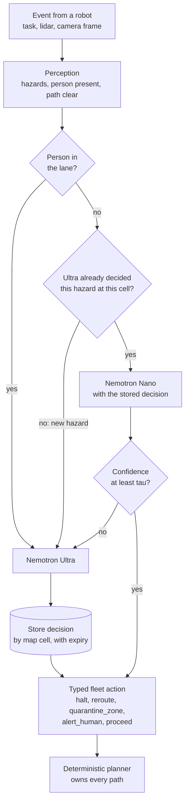
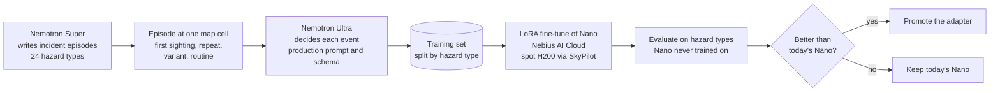
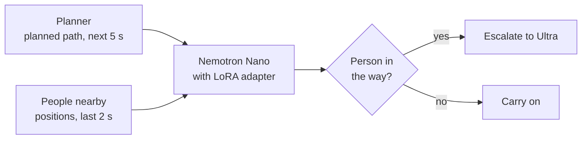
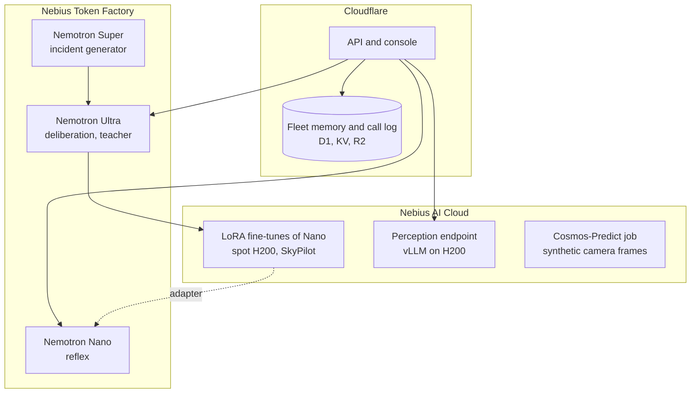

# NemoFleet

**One hazard. One Ultra call. The whole fleet knows. Overnight, the small model learns it.**

NemoFleet is decision-making for robot fleets in data centers, AI factories and warehouses, built on NVIDIA Nemotron running on Nebius. A large model decides each new situation once, the fleet reuses that decision, and a nightly fine-tune teaches the small on-robot model what the large one decided.

- **Live site and console:** https://nemofleet.pages.dev · operator console at https://nemofleet.pages.dev/console
- **Hackathon:** Nebius × NVIDIA Global AI Hackathon, Physical AI track
- **License:** [Apache 2.0](LICENSE)

The robots and the halls are simulated, and the camera frames are rendered images. **Every model call is real**, and every number on this page was measured; where something is a pilot or still in progress, it says so.

## The idea in one picture



During the day the fleet **decides once and shares**. At night it **learns**, so that tomorrow fewer events need the large model.

## The problem

In a data hall or a warehouse, one spill is met by robot after robot. A fleet has two bad options:

- Send every sighting to a frontier reasoning model. That is slow, and the cost grows with the fleet.
- Let a small model guess. That is fast, but it gets things wrong that it has never seen.

In practice, operators halt the whole zone and wait.

## How one event is decided



**Safety invariants:**

- **People escalate.** A person in the lane always goes to Ultra. Fleet memory and peers never settle it, and decisions about people are never reused.
- **Schema first.** Model outputs are constrained by a strict JSON schema and validated again. An invalid answer is retried once, then the robot makes a safe stop.
- **Planner owns motion.** A deterministic A* + CBS planner computes every trajectory. Models choose actions, never paths or coordinates.

**Peer handoff.** When two robots pass, each hands the other the decisions it holds, with a hop count and an expiry, for the dead zones where Wi-Fi fades between tall metal racks.

## Night Shift: how the fleet learns



Every training prompt is built exactly as the live pipeline builds it, so a tuned Nano drops into production unchanged. The tool is `tools/night_shift/distill.cjs`.

**What the pilot showed (48 events, 12 episodes, 2026-10-11).** Agreement means Nano chose the same set of action types as Ultra.

| Event | Today's Nano agrees with Ultra |
|---|---|
| Repeat sighting, with fleet memory | 12 of 12 |
| Routine | 12 of 12 |
| Variant: something changed since the stored decision | 10 of 12 |
| First sighting of a hazard, no memory | 5 of 12 |

- Fleet memory works: with Ultra's earlier decision in hand, Nano matched it every time.
- On new hazards Nano was wrong more often than right, and it never reported confidence below the escalation threshold. Its stated confidence does not separate right from wrong, which is why new hazards are routed to Ultra by rule.
- Ultra cost about $0.0017 per decision (433 tokens in, 425 out).

**After fine-tuning (519 episodes, 2,076 events; tested on 332 events from 4 hazard types Nano never trained on):**

| Event | Nano as served today | Untuned Nano, direct answer | Tuned Nano, direct answer |
|---|---|---|---|
| First sighting of a hazard | 58 of 83 · 70% | 38 of 83 · 46% | **67 of 83 · 81%** |
| Something changed since the stored decision | 60 of 83 · 72% | 40 of 83 · 48% | **64 of 83 · 77%** |
| Repeat sighting, with fleet memory | 73 of 83 · 88% | 60 of 83 · 72% | **80 of 83 · 96%** |
| Routine | 79 of 83 · 95% | 79 of 83 · 95% | 80 of 83 · 96% |
| Any event with a person present | 54 of 85 · 64% | 25 of 85 · 29% | **64 of 85 · 75%** |
| All events | 270 of 332 · 81% | 217 of 332 · 65% | **291 of 332 · 88%** |

- "As served today" is Nano on Token Factory with reasoning on. The tuned model answers directly, with no reasoning step, and still beats it.
- **The escalation gate now works.** Nano's stated confidence is useless: at the 0.62 threshold it would settle 330 of 332 events and be wrong on 12%. Using the probability the tuned model gave to its own actions (threshold picked on validation), it settles 201 of 332 events (61%) and is wrong on 1 of them; the rest go to Ultra.
- Training took 6 minutes on one spot H200; Ultra's 2,076 teaching decisions cost $3.34. Analysis: `tools/night_shift/analyze.py`.

## The safety trigger: is a person in the way?

"A person in the lane always escalates" needs something to notice the person in time. This is a second fine-tune of Nemotron 3 Nano that reads the people around a robot and the robot's planned path, and answers whether someone will be in its way in the next 5 seconds.



Recall at the same false-alarm rate as constant-velocity extrapolation, on held-out recordings (val and test pooled):

| Viewpoint | Constant velocity | Tuned Nano, positions only | Tuned Nano, with the planned path |
|---|---|---|---|
| Robot | 74.1% | 74.5% | **80.1%** |
| Person | 53.9% | 57.6% | **68.5%** |
| Vehicle | 87.8% | 90.0% | 90.0% |

- The untuned model is at chance on this task; after fine-tuning it writes valid JSON every time (300 of 300).
- The gain came from what the model is given, not from more data: a first run without the planned path only matched the baseline.
- The robot result's 95% interval is +0.5 to +11.7 points, and its positives come from 26 episodes, so read it as likely, not settled.
- Training data: THÖR-MAGNI motion capture (robot and person viewpoints), Waymo Open Motion (vehicle viewpoint), and NVIDIA PhysicalAI-SmartSpaces simulation (train only). Each run is about 70 minutes and about $1 on one spot H200.

Details, costs, an independent review and the negative results are in [docs/FINETUNE_PLAN.md](docs/FINETUNE_PLAN.md). The pipeline is `tools/ego_mix/`.

## Where it runs



## Experimental: robotaxis in San Francisco

https://nemofleet.pages.dev/console#sanfrancisco runs the same decision pipeline for a robotaxi fleet on the real streets around Salesforce Tower. Streets and buildings come from OpenStreetMap; vehicle motion is simulated and the dashcam frames are generated with NVIDIA Cosmos-Predict2.5 on a Nebius Serverless Job. Rebuild with `tools/sf_map/build_sf_map.py` (© OpenStreetMap contributors, ODbL) and `tools/cosmos_dream/sf_frames.sh`.

## Architecture: today and next

**Slide deck:** [docs/NemoFleet-Architecture-Today-vs-Next.pdf](docs/NemoFleet-Architecture-Today-vs-Next.pdf). It has five slides:
1. Cover, with numbers measured on the live site
2. Today's architecture, end to end
3. The future state
4. A component-by-component comparison
5. The whole tech stack

Every item on the slides is marked live, wired, in progress, planned or simulated. The deck is built with matplotlib from `docs/build_arch_compare_pdf.py`.

**Today:** one scenario event, from the robot to a fleet action.


**Next:** reflexes on the robot, smarter fleet memory, and the full Night Shift loop on Nebius.


## How we use NVIDIA models and Nebius

| Role | Model | Runs on | Status |
|---|---|---|---|
| Deliberation: new hazards, people, low confidence | `nvidia/Nemotron-3-Ultra-550b-a55b` | Nebius **Token Factory**, Responses API with a strict JSON schema | Live |
| Reflex decisions and reuse of fleet memory | `nvidia/NVIDIA-Nemotron-3-Nano-30B-A3B` | Nebius **Token Factory**, Responses API with a strict JSON schema | Live |
| Night Shift replay: Ultra re-judges Nano's decisions | `nvidia/Nemotron-3-Ultra-550b-a55b` | Nebius **Token Factory** | Live |
| Camera perception | `google/gemma-3-27b-it` | Nebius **Token Factory**, billed per token | Live |
| Camera perception, alternative | `google/gemma-4-26B-A4B-it` | Our **Nebius Serverless AI Endpoint**: vLLM on one H200 | Wired in; switch with one command |
| Camera perception, alternative | `Cosmos3-Super-Reasoner` | Token Factory dedicated endpoint | Wired in; switch with one command |
| Night Shift Dream: possible futures of each camera frame | `nvidia/Cosmos-Predict2.5-2B` | **Nebius Serverless Job** on one H200 | In progress |
| Night Shift incident generator | `nvidia/nemotron-3-super-120b-a12b` | Nebius **Token Factory** | Live in `tools/night_shift` |
| Night Shift Consolidate: LoRA fine-tune of Nano on Ultra's decisions | Nano + LoRA | Nebius **AI Cloud**, spot H200 via SkyPilot | Trained, evaluated and served behind the pipeline on a spot H200 when promoted |
| Safety trigger: person in the way | Nano + LoRA | Nebius **AI Cloud**, spot H200 via SkyPilot | Trained and evaluated; not yet served live |
| Fleet memory and call log | none | Cloudflare D1, KV and R2 | Live |

**Where Token Factory helped:**
- One API key and one base URL for Ultra and Nano. That let us tier the models by cost and latency without running any GPUs for them.
- The Responses API's strict `json_schema` output removed most malformed decisions before our own validator ran.
- Perception runs per token on Token Factory, so the live demo needs no GPU of its own. Gemma 4 isn't served there; it can run on a Serverless AI Endpoint in the same Nebius account.

**Measured on 2026-10-08, live site, both scenarios:**
- Ultra decisions took 1.1–1.9 s each.
- Gemma 4 perception took 0.7–1.2 s per frame.
- Every Nano and Ultra decision passed the schema.
- In each scenario, the repeat sighting of the hazard was settled by fleet memory with no Ultra call. Fleet memory also carries across runs.

The console and the landing page show these numbers live from the database.

## Repository layout

| Path | What |
|---|---|
| `functions/api/[[path]].js` | Backend API on Cloudflare Pages Functions: perception, fleet memory, the Nano/Ultra gate, alarms, actions, Night Shift replay |
| `config/models.yaml` | The single source of model ids, including the perception options and which one is active |
| `scenarios/*.json` | The two scenarios: the warehouse spill (`aisle4-spill`) and the data-center coolant leak (`hall-b-coolant-leak`) |
| `site/` | Landing page, operator console, video and docs pages. Build with `node site/build.cjs`; output goes to `site/dist/` |
| `cloudflare/migrations/` | D1 schema: precedents keyed by map cell, runs, calls, perception, alarms, actions |
| `tools/preflight.cjs` | Checks the key and the model catalog, and makes one real call to each model |
| `tools/use_perception.cjs` | Switches the perception model. It switches only after a real image call returns valid JSON |
| `tools/cosmos_dream/dream.sh` | The Nebius Serverless Job that runs Cosmos-Predict2.5 on the camera frames |
| `tools/run_scenario.cjs` | Command-line scenario runner, with a dry-run mode |
| `tools/night_shift/distill.cjs` | Night Shift: Super writes incident episodes, Ultra and Nano decide them with the production prompt, export for fine-tuning |
| `tools/ego_mix/` | Person-in-the-way fine-tune: dataset adapters, split, baselines, LoRA training and scoring, SkyPilot job |
| `finetuning/experiments/` | Token Factory fine-tuning experiments on other open models, with experiment tracking |
| `waymo_viewer/` | Streamlit viewer for Waymo Open Dataset samples (local use; Waymo data is not redistributed) |
| `tests/qa.cjs` | QA suite: secret scan, syntax checks, build, link check, browser checks of every page at three widths in light and dark, and a local API smoke test |
| `docs/` | [Architecture slide deck (today vs. next)](docs/NemoFleet-Architecture-Today-vs-Next.pdf), [architecture notes](docs/ARCHITECTURE.md), [runbook](docs/RUNBOOK.md), [Nebius plan](docs/NEBIUS_PLAN.md), [platform feedback](docs/FEEDBACK.md) |

## Setup

**You need:**
- Node 20 or newer
- Google Chrome (QA only)
- A Cloudflare account, for Pages, D1, KV and R2
- A Nebius Token Factory API key
- For Gemma 4 or the Cosmos job: the Nebius CLI and a Hugging Face token

```bash
git clone https://github.com/gretchenboria/NemoFleet && cd NemoFleet
cp .env.example .env                       # add NEBIUS_API_KEY (and the others you use); .env is gitignored
cd docs/video && npm install && cd ../..   # puppeteer-core, used by QA
node tools/preflight.cjs                   # one real call to Ultra, Nano and Super; exits 0 only if all answer
```

### Run locally

```bash
node site/build.cjs
npx wrangler d1 migrations apply nemofleet-memory --local -c cloudflare/wrangler.jsonc
cp .env .dev.vars                          # wrangler reads secrets from .dev.vars
npx wrangler pages dev site/dist --d1 MEMORY=<your D1 id> --kv TAGS --r2 RUNS
```

Open http://localhost:8788/console.html, pick **Warehouse** or **Data center**, and click **Run scenario**. Each event makes real calls: perception, the fleet-memory lookup, then Nano or Ultra. The run list shows which step settled each event.

### Deploy your own copy

1. Create a D1 database, a KV namespace and an R2 bucket, and put their ids in `wrangler.jsonc` and `cloudflare/wrangler.jsonc`.
2. Apply the schema to the remote database:
   ```bash
   npx wrangler d1 migrations apply nemofleet-memory --remote -c cloudflare/wrangler.jsonc
   ```
3. Set the secrets:
   ```bash
   npx wrangler pages secret put NEBIUS_API_KEY --project-name <project>
   npx wrangler pages secret put GEMMA4_ENDPOINT_TOKEN --project-name <project>   # only if perception uses Gemma 4
   ```
4. Run QA, then deploy. Deploy only when QA exits 0:
   ```bash
   node tests/qa.cjs && npx wrangler pages deploy site/dist --project-name <project>
   ```

### Perception: Gemma 4 on a Nebius Serverless Endpoint

Create the endpoint. It bills per hour while it runs; stop it when you're not using it.

```bash
nebius ai endpoint create --parent-id <project-id> --name nemofleet-gemma4 \
  --image vllm/vllm-openai:v0.30.0 --container-port 8000 --platform gpu-h200-sxm \
  --auth token --token "$GEMMA4_ENDPOINT_TOKEN" --disk-size 200Gi --shm-size 16Gi \
  --args "--model google/gemma-4-26B-A4B-it --max-model-len 16384"
```

Then point NemoFleet at it. This makes a real image call first and switches only if it answers with valid JSON:

```bash
node tools/use_perception.cjs gemma4 --base https://<endpoint-host>/v1
node tools/use_perception.cjs              # list the options and show the active one
node tools/use_perception.cjs cosmos       # switch to the Cosmos dedicated endpoint once it is running
```

Rebuild and redeploy after switching.

### Night Shift Dream: Cosmos-Predict2.5 on a Nebius Serverless Job

First accept the NVIDIA Open Model License on Hugging Face for both `nvidia/Cosmos-Predict2.5-2B` and `nvidia/Cosmos-Guardrail1`. Then:

```bash
nebius ai job create --parent-id <project-id> --name nemofleet-cosmos-dream \
  --image nvidia/cuda:12.8.1-cudnn-devel-ubuntu24.04 --platform gpu-h200-sxm --disk-size 300Gi --shm-size 32Gi --timeout 3h \
  --inject-file tools/cosmos_dream/dream.sh:/job/dream.sh --container-command bash --args /job/dream.sh \
  --env HF_TOKEN=$HF_TOKEN --env DREAM_REPO=<hf-user>/nemofleet-dreams
```

The job generates short clips of possible futures from the camera frames and uploads them, with its log, to a private Hugging Face dataset.

## What is not built yet

- **Always-on serving of the tuned Nano.** It runs behind the pipeline when its spot endpoint is up and the adapter is promoted; otherwise the pipeline uses the served Nano.
- **Night Shift Gate.** Promoting an adapter automatically only when it beats today's Nano.
- **Dead-zone offline mode.** Robots that know only what their peers handed them.
- **Real robots.** Motion on the console's floor view is simulated, and the camera frames are rendered.

## Feedback on Nebius and NVIDIA tools

See [docs/FEEDBACK.md](docs/FEEDBACK.md). Highlights from building this:
- On Token Factory's Responses API, `response_format` and `max_completion_tokens` are silently ignored; use `text.format` and `max_output_tokens`.
- `max_output_tokens` includes reasoning tokens, so a low cap returns an empty answer.
- `reasoning.effort` had no measurable effect on Nemotron 3 Ultra.
- The Cosmos3 dedicated endpoint stayed in "starting" for more than a day.
- Gemma 4 is not on Token Factory. Self-hosting it on a Serverless Endpoint with vLLM worked first time.
