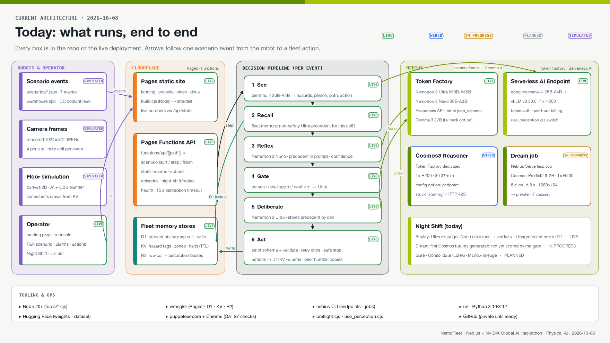
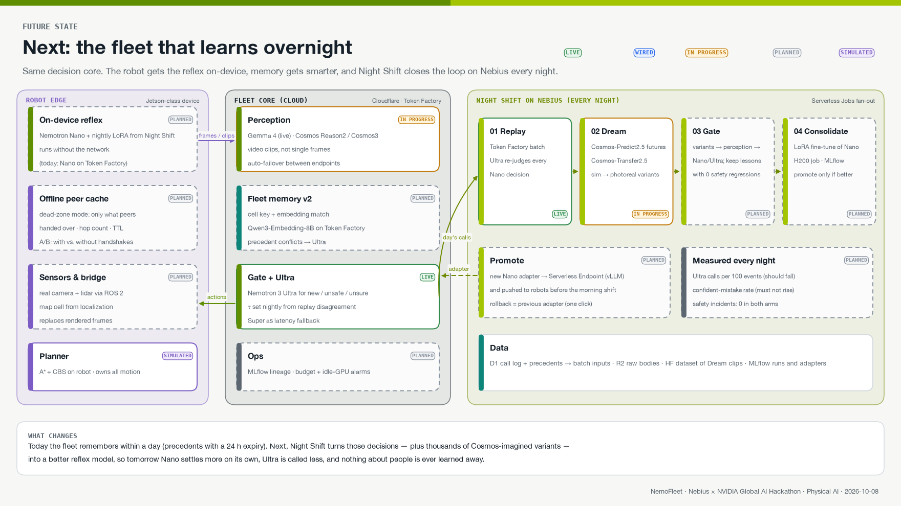

# NemoFleet

**One hazard. One Ultra call. The whole fleet knows.**

NemoFleet is decision-making for robot fleets in warehouses and data centers, built on NVIDIA Nemotron running on Nebius. When a robot meets something new, like a spill in aisle 4 or a coolant leak at the end of row C2, **Nemotron 3 Ultra** works out what to do. NemoFleet stores that decision against the map cell. Every robot that reaches the cell afterwards reuses it through **Nemotron 3 Nano** instead of paying for the same reasoning again. A person in the lane is never reused: that always goes back to Ultra.

- **Live site and console:** https://nemofleet.pages.dev · operator console at https://nemofleet.pages.dev/console
- **Hackathon:** Nebius × NVIDIA Global AI Hackathon, Physical AI track
- **License:** [Apache 2.0](LICENSE)

The robots, the warehouse and the data-center hall are simulated, and the camera frames are rendered images. **Every model call is real.** The console shows each call's latency, tokens and output from the database, and nothing in it is a placeholder.

## The problem

In a warehouse or a data-center hall, one spill is met by robot after robot. Today a fleet has two bad options:
- Send every sighting to a frontier reasoning model. That is slow, and the cost grows with the fleet.
- Let a small model guess. That is fast, but it gets things wrong that it has never seen.

In practice, operators halt the whole zone and wait.

## How it works

Each event a robot reports goes through three steps.

1. **See.** The robot's camera frame goes to a vision model, which returns structured JSON: hazards, whether a person is present, whether the path is clear, and a recommended action.
2. **Decide.** Nemotron Nano returns typed fleet actions (`halt`, `reroute`, `quarantine_zone`, `alert_human`, …) with a confidence score. Three kinds of event go to Nemotron Ultra instead:
   - a hazard the fleet hasn't seen
   - a person in the lane
   - a Nano answer below the confidence threshold τ
3. **Remember.** Ultra's decision is stored against the map cell, with an expiry.
   - The next robot at that cell gets the decision in Nano's prompt, and no Ultra call is made.
   - If what that robot sees differs, Nano lowers its confidence and the decision goes back to Ultra.
   - Decisions about people are never reused.

**Safety invariants:**
- **People escalate.** A person in the lane always goes to Ultra; fleet memory and peers never settle it.
- **Schema first.** Model outputs are constrained by a strict JSON schema and then validated again. An invalid answer is retried once, then the robot makes a safe stop.
- **Planner owns motion.** A deterministic A* + CBS planner computes every trajectory. Models choose actions, never paths or coordinates.

**Peer handoff.** When two robots pass, each hands the other the decisions it holds, with a hop count and an expiry. The point is dead zones: Wi-Fi fades between tall metal racks and at the end of cold aisles.
- Today the handoff copies decisions in fleet memory.
- Next: an offline mode, where a robot knows only what its peers handed it.

## Experimental: robotaxis in San Francisco

https://nemofleet.pages.dev/console#sanfrancisco runs the same decision pipeline for a robotaxi fleet on the real streets around Salesforce Tower.

**What's real:**
- The streets and buildings come from OpenStreetMap. One-way streets are respected.
- Every model call is real.

**What's simulated:** vehicle motion. The dashcam frames are synthetic, generated with NVIDIA **Cosmos-Predict2.5** (text2world) on a Nebius Serverless Job.

**The scenario:**
- A double-parked delivery truck blocks Fremont St between Mission and Howard. The first robotaxi to see it gets an Ultra decision, and the next robotaxi reuses that decision from fleet memory.
- A pedestrian in the 1st & Mission crosswalk always goes to Ultra.
- Later, a fire engine and a cyclist appear on the same block. Because a person is involved, the stored decision is not reused and the event goes to Ultra.

**Rebuild the map and frames:**
- Map: `tools/sf_map/build_sf_map.py`, which builds from `tools/sf_map/osm-soma.json` (© OpenStreetMap contributors, ODbL).
- Frames: `tools/cosmos_dream/sf_frames.sh`.

## Architecture: today and next

**Slide deck:** [docs/NemoFleet-Architecture-Today-vs-Next.pdf](docs/NemoFleet-Architecture-Today-vs-Next.pdf). It has five slides:
1. Cover, with numbers measured on the live site
2. Today's architecture, end to end
3. The future state
4. A component-by-component comparison
5. The whole tech stack

Every item on the slides is marked live, wired, in progress, planned or simulated. The deck is built with matplotlib from `docs/build_arch_compare_pdf.py`.

**Today:** one scenario event, from the robot to a fleet action.



**Next:** reflexes on the robot, smarter fleet memory, and the full Night Shift loop on Nebius.



## How we use NVIDIA models and Nebius

| Role | Model | Runs on | Status |
|---|---|---|---|
| Deliberation: new hazards, people, low confidence | `nvidia/Nemotron-3-Ultra-550b-a55b` | Nebius **Token Factory**, Responses API with a strict JSON schema | Live |
| Reflex decisions and reuse of fleet memory | `nvidia/NVIDIA-Nemotron-3-Nano-30B-A3B` | Nebius **Token Factory**, Responses API with a strict JSON schema | Live |
| Night Shift replay: Ultra re-judges Nano's decisions | `nvidia/Nemotron-3-Ultra-550b-a55b` | Nebius **Token Factory** | Live |
| Camera perception | `google/gemma-4-26B-A4B-it` | Our **Nebius Serverless AI Endpoint**: vLLM on one H200 | Live |
| Camera perception, alternative | `Cosmos3-Super-Reasoner` | Token Factory dedicated endpoint | Wired in; switch with one command |
| Night Shift Dream: possible futures of each camera frame | `nvidia/Cosmos-Predict2.5-2B` | **Nebius Serverless Job** on one H200 | In progress |
| Night Shift Gate and Consolidate (LoRA fine-tune of Nano) | Nano + LoRA | Nebius Serverless Jobs | Planned |
| Fleet memory and call log | none | Cloudflare D1, KV and R2 | Live |

**Where Token Factory helped:**
- One API key and one base URL for Ultra and Nano. That let us tier the models by cost and latency without running any GPUs for them.
- The Responses API's strict `json_schema` output removed most malformed decisions before our own validator ran.
- Gemma 4 isn't served on Token Factory, so it runs on a Serverless AI Endpoint in the same Nebius account.

**Measured on 2026-10-08, live site, both scenarios:**
- Ultra decisions took 1.1–1.9 s each.
- Gemma 4 perception took 0.7–1.2 s per frame.
- Every Nano and Ultra decision passed the schema.
- In each scenario, the repeat sighting of the hazard was settled by fleet memory with no Ultra call. Fleet memory also carries across runs.

The console and the landing page show these numbers live from the database.

## Repository layout

| Path | What |
|---|---|
| `functions/api/[[path]].js` | Backend API on Cloudflare Pages Functions: perception, fleet memory, the Nano/Ultra gate, alarms, actions, Night Shift replay |
| `config/models.yaml` | The single source of model ids, including the perception options and which one is active |
| `scenarios/*.json` | The two scenarios: the warehouse spill (`aisle4-spill`) and the data-center coolant leak (`hall-b-coolant-leak`) |
| `site/` | Landing page, operator console, video and docs pages. Build with `node site/build.cjs`; output goes to `site/dist/` |
| `cloudflare/migrations/` | D1 schema: precedents keyed by map cell, runs, calls, perception, alarms, actions |
| `tools/preflight.cjs` | Checks the key and the model catalog, and makes one real call to each model |
| `tools/use_perception.cjs` | Switches the perception model. It switches only after a real image call returns valid JSON |
| `tools/cosmos_dream/dream.sh` | The Nebius Serverless Job that runs Cosmos-Predict2.5 on the camera frames |
| `tools/run_scenario.cjs` | Command-line scenario runner, with a dry-run mode |
| `tests/qa.cjs` | QA suite: secret scan, syntax checks, build, link check, browser checks of every page at three widths in light and dark, and a local API smoke test |
| `docs/` | [Architecture slide deck (today vs. next)](docs/NemoFleet-Architecture-Today-vs-Next.pdf), [architecture notes](docs/ARCHITECTURE.md), [runbook](docs/RUNBOOK.md), [Nebius plan](docs/NEBIUS_PLAN.md), [platform feedback](docs/FEEDBACK.md) |

## Setup

**You need:**
- Node 20 or newer
- Google Chrome (QA only)
- A Cloudflare account, for Pages, D1, KV and R2
- A Nebius Token Factory API key
- For Gemma 4 or the Cosmos job: the Nebius CLI and a Hugging Face token

```bash
git clone https://github.com/gretchenboria/NemoFleet && cd NemoFleet
cp .env.example .env                       # add NEBIUS_API_KEY (and the others you use); .env is gitignored
cd docs/video && npm install && cd ../..   # puppeteer-core, used by QA
node tools/preflight.cjs                   # one real call to Ultra, Nano and Super; exits 0 only if all answer
```

### Run locally

```bash
node site/build.cjs
npx wrangler d1 migrations apply nemofleet-memory --local -c cloudflare/wrangler.jsonc
cp .env .dev.vars                          # wrangler reads secrets from .dev.vars
npx wrangler pages dev site/dist --d1 MEMORY=<your D1 id> --kv TAGS --r2 RUNS
```

Open http://localhost:8788/console.html, pick **Warehouse** or **Data center**, and click **Run scenario**. Each event makes real calls: perception, the fleet-memory lookup, then Nano or Ultra. The run list shows which step settled each event.

### Deploy your own copy

1. Create a D1 database, a KV namespace and an R2 bucket, and put their ids in `wrangler.jsonc` and `cloudflare/wrangler.jsonc`.
2. Apply the schema to the remote database:
   ```bash
   npx wrangler d1 migrations apply nemofleet-memory --remote -c cloudflare/wrangler.jsonc
   ```
3. Set the secrets:
   ```bash
   npx wrangler pages secret put NEBIUS_API_KEY --project-name <project>
   npx wrangler pages secret put GEMMA4_ENDPOINT_TOKEN --project-name <project>   # only if perception uses Gemma 4
   ```
4. Run QA, then deploy. Deploy only when QA exits 0:
   ```bash
   node tests/qa.cjs && npx wrangler pages deploy site/dist --project-name <project>
   ```

### Perception: Gemma 4 on a Nebius Serverless Endpoint

Create the endpoint. It bills per hour while it runs; stop it when you're not using it.

```bash
nebius ai endpoint create --parent-id <project-id> --name nemofleet-gemma4 \
  --image vllm/vllm-openai:v0.30.0 --container-port 8000 --platform gpu-h200-sxm \
  --auth token --token "$GEMMA4_ENDPOINT_TOKEN" --disk-size 200Gi --shm-size 16Gi \
  --args "--model google/gemma-4-26B-A4B-it --max-model-len 16384"
```

Then point NemoFleet at it. This makes a real image call first and switches only if it answers with valid JSON:

```bash
node tools/use_perception.cjs gemma4 --base https://<endpoint-host>/v1
node tools/use_perception.cjs              # list the options and show the active one
node tools/use_perception.cjs cosmos       # switch to the Cosmos dedicated endpoint once it is running
```

Rebuild and redeploy after switching.

### Night Shift Dream: Cosmos-Predict2.5 on a Nebius Serverless Job

First accept the NVIDIA Open Model License on Hugging Face for both `nvidia/Cosmos-Predict2.5-2B` and `nvidia/Cosmos-Guardrail1`. Then:

```bash
nebius ai job create --parent-id <project-id> --name nemofleet-cosmos-dream \
  --image nvidia/cuda:12.8.1-cudnn-devel-ubuntu24.04 --platform gpu-h200-sxm --disk-size 300Gi --shm-size 32Gi --timeout 3h \
  --inject-file tools/cosmos_dream/dream.sh:/job/dream.sh --container-command bash --args /job/dream.sh \
  --env HF_TOKEN=$HF_TOKEN --env DREAM_REPO=<hf-user>/nemofleet-dreams
```

The job generates short clips of possible futures from the camera frames and uploads them, with its log, to a private Hugging Face dataset.

## What is not built yet

- **Night Shift Gate and Consolidate.** Gating lessons against normal operations, and the LoRA fine-tune of Nano.
- **Dead-zone offline mode.** Robots that know only what their peers handed them.
- **Real robots.** Motion on the console's floor view is simulated, and the camera frames are rendered.

## Feedback on Nebius and NVIDIA tools

See [docs/FEEDBACK.md](docs/FEEDBACK.md). Highlights from building this:
- On Token Factory's Responses API, `response_format` and `max_completion_tokens` are silently ignored; use `text.format` and `max_output_tokens`.
- `max_output_tokens` includes reasoning tokens, so a low cap returns an empty answer.
- `reasoning.effort` had no measurable effect on Nemotron 3 Ultra.
- The Cosmos3 dedicated endpoint stayed in "starting" for more than a day.
- Gemma 4 is not on Token Factory. Self-hosting it on a Serverless Endpoint with vLLM worked first time.
