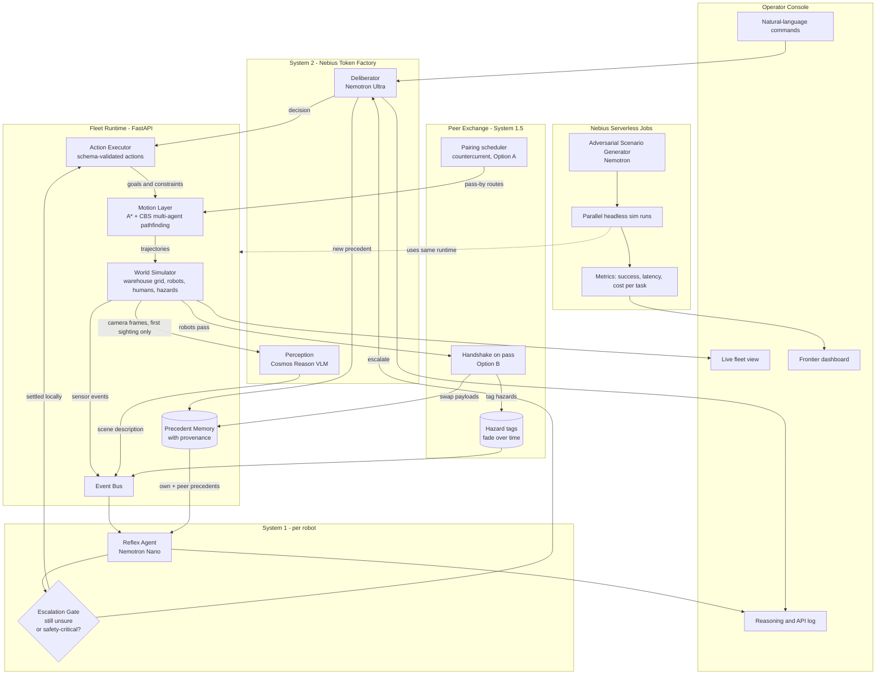
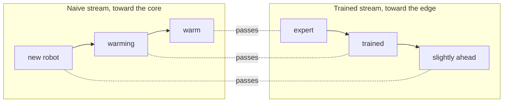
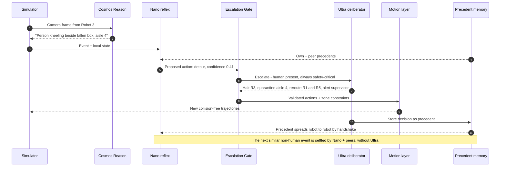
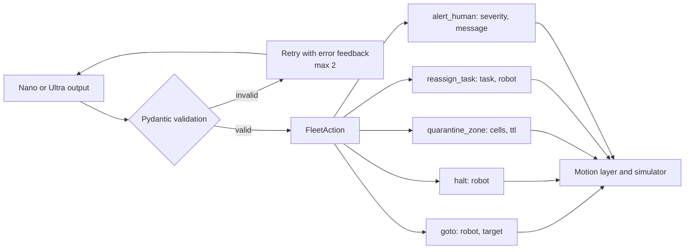
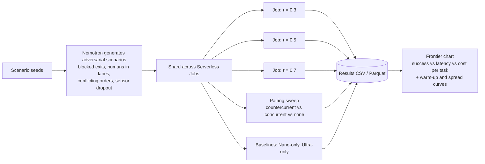

# NemoFleet Architecture

📄 **Print-ready version:** [NemoFleet-Architecture.pdf](NemoFleet-Architecture.pdf)
🦆 **Fleet-learning options:** [NemoFleet-Countercurrent-Options.pdf](NemoFleet-Countercurrent-Options.pdf)

NemoFleet splits robot-fleet cognition into speeds, the way people do, and lets robots learn from each other in between:

- **System 1 (reflex):** a small, fast model on each robot handles routine events in under a second.
- **Peer exchange (System 1.5):** robots share what they know when they pass each other, so the fleet settles most new-but-already-seen problems without calling the cloud.
- **System 2 (deliberation):** a large reasoning model in the cloud handles novel or high-stakes events, and only those.

Geometry is never delegated to an LLM. A deterministic planner owns every trajectory, so every path is collision-free by construction. The models decide *what* should happen; the planner decides *how* to move.

The peer layer combines two designs from the [countercurrent options](NemoFleet-Countercurrent-Options.pdf):

- **Option B, ant-trail antennation (runtime):** robots swap a small payload when they pass in a lane, and hazards are tagged on map cells that fade over time.
- **Option A, countercurrent curriculum (learning):** a pairing scheduler routes robots so newer robots pass peers that are only slightly more trained first, then progressively more expert ones.

---

## 1. System map



---

## 2. Peer learning layer (Options B and A)

### How a handshake works (Option B)

When two robots moving in opposite directions come within handshake range, the simulator emits a `pass` event and they swap a small, bounded payload. Neither robot calls a model.

```mermaid
sequenceDiagram
    participant O as Outbound robot
    participant I as Inbound robot
    participant T as Hazard tags
    participant N as Nano, next event

    O->>I: New orders, policy delta, map changes
    I->>O: Hazards ahead, fresh frontier precedents, congestion
    I->>T: Refresh tags on cells it just saw
    Note over T: Tags decay; stale warnings expire on their own
    O->>N: Next spill ahead: matching peer precedent in context
    N-->>O: Confident: settled locally, no Cosmos or Ultra call
```

### How pairing works (Option A)

The pairing scheduler adds pass-by waypoints to routes so each robot meets peers in gradient order. Robot "temperature" is a competence score (precedent coverage and recent escalation rate).



Each pass carries a *small* difference, so the payload fits the contact time and context budget. Random ("concurrent") pairing plateaus once both robots know the same things.

### Safety rules for peer knowledge

- **Peers never override safety.** A human present, an unknown hazard class, or a blocked exit always escalates to Ultra, whatever the peer cache says.
- **Every precedent carries provenance:** who decided it (Ultra or a peer), when, and how many hops it has travelled. Confidence decays with each hop.
- **Precedents and tags expire** (TTL), so a bad or outdated lesson can't circulate forever.
- **Ultra decisions outrank peer ones.** A conflict between precedents is itself an escalation trigger.

---

## 3. Escalation sequence: a person enters a robot lane



---

## 4. Responsibility split

| Layer | Model or algorithm | Decides | Latency target | Never does |
|---|---|---|---|---|
| Perception | Cosmos Reason | What the camera sees, on first sighting | ~1 s | Plan actions |
| Reflex | Nemotron Nano | Routine responses, plus a confidence score | < 1 s | Handle safety-critical novel events alone |
| Peer exchange | Handshake + fading tags + pairing scheduler | What the fleet already knows reaches this robot | < 50 ms, no model call | Override a safety escalation |
| Escalation gate | Rules + threshold τ | Whether the robot and its peers have settled it, or System 2 is needed | ~0 | Generate content |
| Deliberation | Nemotron Ultra | Novel and high-stakes decisions, task re-prioritization | 5–30 s | Produce raw coordinates |
| Motion | A* + CBS | Exact collision-free paths, including pass-by waypoints | < 10 ms | Interpret semantics |
| Executor | Pydantic schemas | Whether an action is valid | ~0 | Accept malformed LLM output |

---

## 5. Action schema boundary

The LLMs speak in high-level, schema-validated intents. Anything that fails validation is rejected and retried, never executed.



---

## 6. Red-team frontier pipeline

This produces the headline results:

- **Escalation frontier:** success, latency, and cost across escalation thresholds τ, comparing Nano-only, Ultra-only, and the hybrid.
- **Peer-learning result (Option A):** countercurrent vs. concurrent (random) vs. no-peer pairing, measured as Ultra calls per novel event and how fast new robots warm up.
- **Spread result (Option B):** Cosmos and Ultra calls per hazard, and how long a new hazard takes to reach the whole fleet.



---

## 7. Planned module layout

```
nemofleet/
├── models.py          # Pydantic: WorldState, Robot, Event, FleetAction, Decision, Precedent
├── sim/
│   ├── world.py       # Warehouse grid, robots, humans, hazards, tick loop
│   ├── proximity.py   # Pass detection, handshake events, fading hazard tags (Option B)
│   └── scenarios.py   # Scenario loading and procedural generation
├── motion/
│   ├── astar.py       # Single-agent shortest path
│   └── cbs.py         # Conflict-based search for multi-agent paths
├── cognition/
│   ├── client.py      # Token Factory client (OpenAI-compatible)
│   ├── reflex.py      # Nemotron Nano, System 1
│   ├── peers.py       # Handshake payloads, merge rules, provenance and TTL (Option B)
│   ├── pairing.py     # Countercurrent pairing scheduler, competence scores (Option A)
│   ├── deliberator.py # Nemotron Ultra, System 2
│   ├── gate.py        # Escalation policy, including safety overrides
│   ├── perception.py  # Cosmos Reason wrapper
│   └── memory.py      # Precedent store and retrieval
├── api/
│   └── server.py      # FastAPI: /state, /command, /inject, /tick, /log
├── ui/                # Operator console
└── jobs/
    ├── redteam.py     # Serverless Job entry point (τ sweep + pairing sweep)
    └── frontier.py    # Aggregation and charts
```

---

## 8. Where NVIDIA and Nebius are used

| Component | NVIDIA model | Nebius service |
|---|---|---|
| Reflex agent | Nemotron Nano | Token Factory |
| Deliberator | Nemotron Ultra | Token Factory |
| Perception | Cosmos Reason | Token Factory or AI Cloud endpoint |
| Scenario generator | Nemotron Super | Token Factory |
| Peer exchange | None: settling problems without a model call is the point | — |
| Red-team and pairing sweeps | — | Serverless Jobs |

Confirm the exact model IDs against the Token Factory catalog before wiring up the client.
