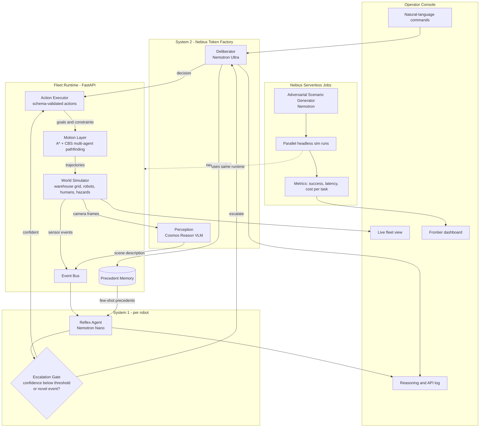
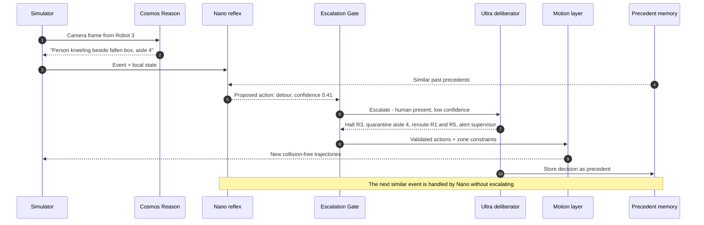
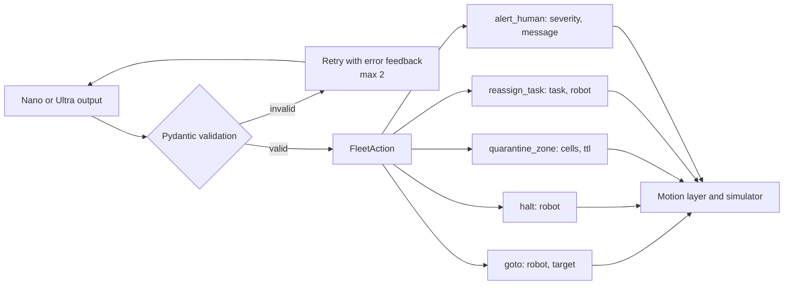
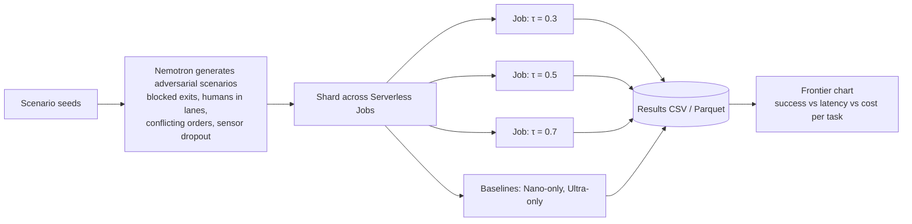

# NemoFleet Architecture

📄 **Print-ready version:** [NemoFleet-Architecture.pdf](NemoFleet-Architecture.pdf)

NemoFleet splits robot-fleet cognition into two speeds, the way people do:

- **System 1 (reflex):** a small, fast model on each robot handles routine events in under a second.
- **System 2 (deliberation):** a large reasoning model in the cloud handles novel or high-stakes events, and only those.

Geometry is never delegated to an LLM. A deterministic planner owns every trajectory, so every path is collision-free by construction. The models decide *what* should happen; the planner decides *how* to move.

---

## 1. System map



---

## 2. Escalation sequence: a person enters a robot lane



---

## 3. Responsibility split

| Layer | Model or algorithm | Decides | Latency target | Never does |
|---|---|---|---|---|
| Perception | Cosmos Reason | What the camera sees | ~1 s | Plan actions |
| Reflex | Nemotron Nano | Routine responses, plus a confidence score | < 1 s | Handle safety-critical novel events alone |
| Escalation gate | Rules + threshold τ | Whether to call System 2 | ~0 | Generate content |
| Deliberation | Nemotron Ultra | Novel and high-stakes decisions, task re-prioritization | 5–30 s | Produce raw coordinates |
| Motion | A* + CBS | Exact collision-free paths | < 10 ms | Interpret semantics |
| Executor | Pydantic schemas | Whether an action is valid | ~0 | Accept malformed LLM output |

---

## 4. Action schema boundary

The LLMs speak in high-level, schema-validated intents. Anything that fails validation is rejected and retried, never executed.



---

## 5. Red-team frontier pipeline

This produces the headline result: success, latency, and cost across escalation thresholds, comparing Nano-only, Ultra-only, and the hybrid.



---

## 6. Planned module layout

```
nemofleet/
├── models.py          # Pydantic: WorldState, Robot, Event, FleetAction, Decision
├── sim/
│   ├── world.py       # Warehouse grid, robots, humans, hazards, tick loop
│   └── scenarios.py   # Scenario loading and procedural generation
├── motion/
│   ├── astar.py       # Single-agent shortest path
│   └── cbs.py         # Conflict-based search for multi-agent paths
├── cognition/
│   ├── client.py      # Token Factory client (OpenAI-compatible)
│   ├── reflex.py      # Nemotron Nano, System 1
│   ├── deliberator.py # Nemotron Ultra, System 2
│   ├── gate.py        # Escalation policy
│   ├── perception.py  # Cosmos Reason wrapper
│   └── memory.py      # Precedent store and retrieval
├── api/
│   └── server.py      # FastAPI: /state, /command, /inject, /tick, /log
├── ui/                # Operator console
└── jobs/
    ├── redteam.py     # Serverless Job entry point
    └── frontier.py    # Aggregation and charts
```

---

## 7. Where NVIDIA and Nebius are used

| Component | NVIDIA model | Nebius service |
|---|---|---|
| Reflex agent | Nemotron Nano | Token Factory |
| Deliberator | Nemotron Ultra | Token Factory |
| Perception | Cosmos Reason | Token Factory or AI Cloud endpoint |
| Scenario generator | Nemotron Super | Token Factory |
| Red-team runs | — | Serverless Jobs |

Confirm the exact model IDs against the Token Factory catalog before wiring up the client.
