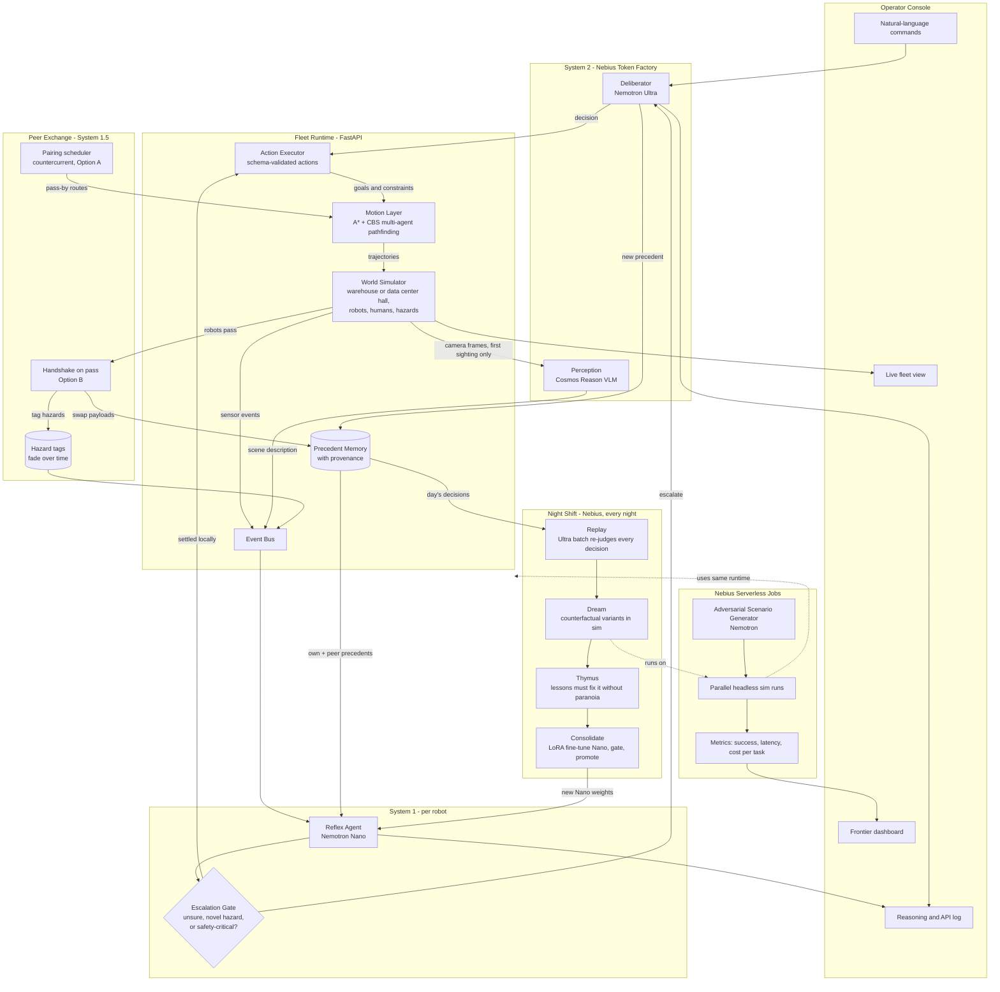
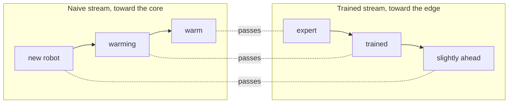
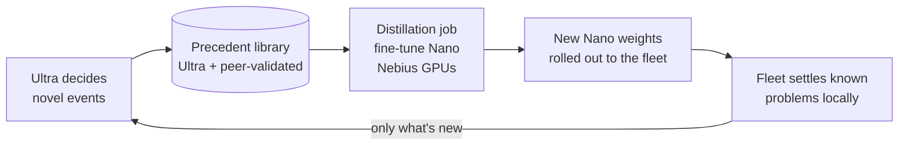
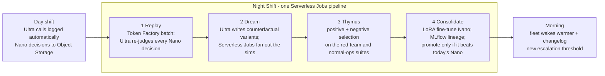
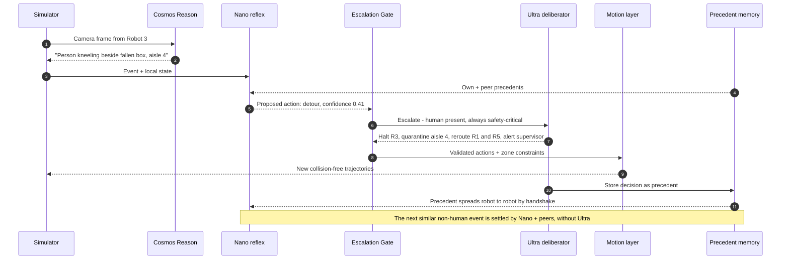
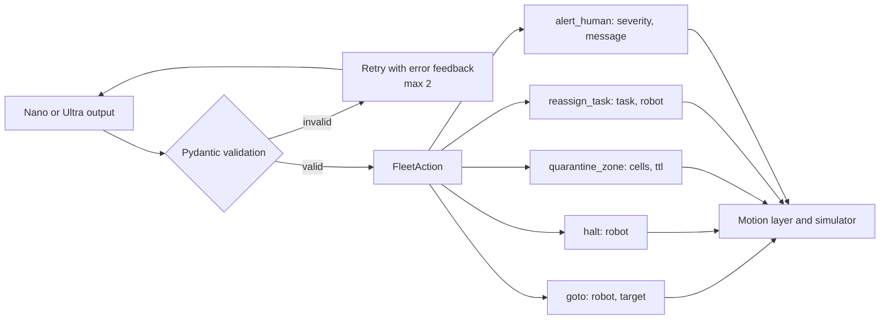
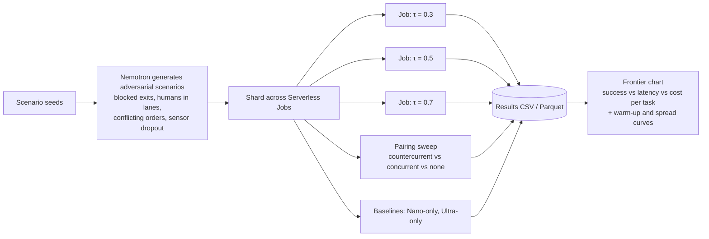
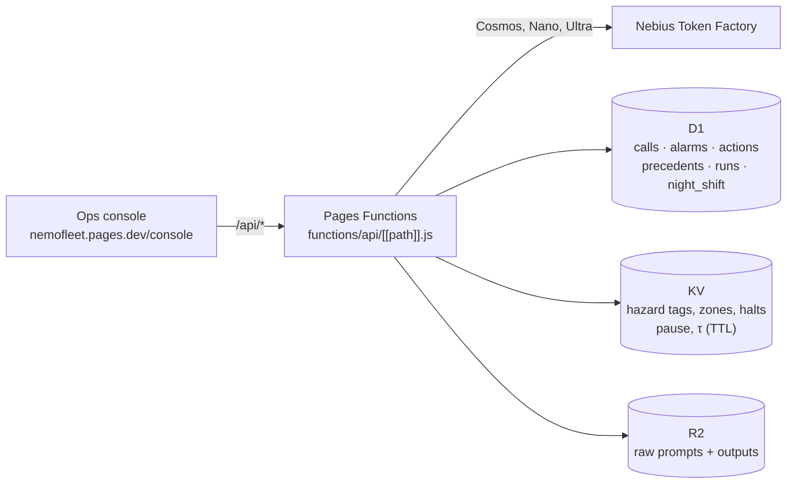

# NemoFleet Architecture

📄 **Print-ready version:** [NemoFleet-Architecture.pdf](NemoFleet-Architecture.pdf)
🦆 **Fleet-learning options:** [NemoFleet-Countercurrent-Options.pdf](NemoFleet-Countercurrent-Options.pdf)
✅ **Agreed implementation plan:** [NEBIUS_PLAN.md](NEBIUS_PLAN.md). Where it differs from this doc (Cosmos and countercurrent pairing are stretch goals; the thymus is folded into the promotion gate), the plan wins.

NemoFleet splits robot-fleet cognition into speeds, the way people do, and lets robots learn from each other in between:

- **System 1 (reflex):** a small, fast model on each robot handles routine events in under a second.
- **Peer exchange (System 1.5):** robots share what they know when they pass each other, so the fleet settles most new-but-already-seen problems without calling the cloud.
- **System 2 (deliberation):** a large reasoning model in the cloud handles novel or high-stakes events, and only those.
- **Night Shift (the warm core):** every night the fleet "dreams" on Nebius. Ultra reviews the day's decisions, imagines variations of the hardest moments, Serverless Jobs live through them in simulation, and the lessons that survive are trained into Nano, so the fleet wakes up warmer.

**Nebius is the warm core.** Like a duck that keeps heat in its body and lets its feet run cheap, NemoFleet doesn't cut compute; it moves it. Instead of re-solving problems the fleet already solved, compute goes to what only the core can do: deliberating on new problems (Token Factory), stress-testing the fleet at scale (Serverless Jobs), and learning from experience (fine-tuning). Cheaper decisions per robot also mean operators can run more robots on the same budget.

**Two sites, one design.** The same fleet runs in a fulfillment-center **warehouse** (DC-04, a liquid spill at an aisle 4 blind corner) and a hyperscale **data center** hall (hall B, a coolant leak at the end of row C2). Only the scenario file and the robot types change; the gate, the peer layer, the schema and Night Shift are identical. See [section 11](#11-two-sites) and the [demo use case](DEMO.md).

Geometry is never delegated to an LLM. A deterministic planner owns every trajectory, so every path is collision-free by construction. The models decide *what* should happen; the planner decides *how* to move.

The peer layer combines two designs from the [countercurrent options](NemoFleet-Countercurrent-Options.pdf):

- **Option B, ant-trail antennation (runtime):** robots swap a small payload when they pass in a lane, and hazards are tagged on map cells that fade over time.
- **Option A, countercurrent curriculum (learning):** a pairing scheduler routes robots so newer robots pass peers that are only slightly more trained first, then progressively more expert ones.

---

## 1. System map



---

## 2. Peer learning layer (Options B and A)

### How a handshake works (Option B)

When two robots moving in opposite directions come within handshake range, the simulator emits a `pass` event and they swap a small, bounded payload. Neither robot calls a model.

```mermaid
sequenceDiagram
    participant O as Outbound robot
    participant I as Inbound robot
    participant T as Hazard tags
    participant N as Nano, next event

    O->>I: New orders, policy delta, map changes
    I->>O: Hazards ahead, fresh frontier precedents, congestion
    I->>T: Refresh tags on cells it just saw
    Note over T: Tags decay; stale warnings expire on their own
    O->>N: Next spill ahead: matching peer precedent in context
    N-->>O: Confident: settled locally, no Cosmos or Ultra call
```

### How pairing works (Option A)

The pairing scheduler adds pass-by waypoints to routes so each robot meets peers in gradient order. Robot "temperature" is a competence score (precedent coverage and recent escalation rate).



Each pass carries a *small* difference, so the payload fits the contact time and context budget. Random ("concurrent") pairing plateaus once both robots know the same things.

### Safety rules for peer knowledge

- **Peers never override safety.** A human present, an unknown hazard class, or a blocked exit always escalates to Ultra, whatever the peer cache says.
- **Every precedent carries provenance:** who decided it (Ultra or a peer), when, and how many hops it has travelled. Confidence decays with each hop.
- **Precedents and tags expire** (TTL), so a bad or outdated lesson can't circulate forever.
- **Ultra decisions outrank peer ones.** A conflict between precedents is itself an escalation trigger.

---

## 3. The warm core: where Nebius compute goes

Every Ultra decision becomes a precedent, and peers spread precedents through the fleet. Every night, [Night Shift](#4-night-shift-the-fleet-dreams-on-nebius) fine-tunes Nano on what the fleet learned, so knowledge moves from the context window into the model weights. New robots then start warm, and Ultra's time is freed for genuinely new problems, which in turn produce new precedents.



- **Gate before rollout:** a distilled Nano ships only if it beats the current one on the red-team scenario suite, run on Serverless Jobs.
- **What's trained on:** Ultra decisions, plus peer decisions that held up (no later conflict or escalation). Safety-critical cases stay with Ultra regardless.
- **Where it runs:** Token Factory fine-tuning, or a training job on Nebius AI Cloud GPUs. Confirm which Nemotron models support fine-tuning before choosing.

| Workload | Runs on | Grows with |
|---|---|---|
| Deliberation on novel events | Token Factory (Nemotron Ultra) | New sites, new hazard types, fleet size |
| Reflex inference | Token Factory (Nemotron Nano) | Robots × events; per-robot cost falls, so fleets grow |
| Perception on first sighting | Token Factory (Cosmos Reason) | New hazards |
| Red-team and pairing sweeps | Serverless Jobs | Scenarios × thresholds × pairing strategies |
| Night Shift (replay, dream, thymus, consolidate) | Token Factory batch + Serverless Jobs + MLflow | Incidents per day × dreams per incident × fleets |

---

## 4. Night Shift: the fleet dreams on Nebius

> *The edge lived it once. Nebius lived it 300 times.*

Animals consolidate memory during sleep: the hippocampus replays the day's most important experiences at high speed, including paths never taken, and the immune system's thymus deletes the cells that would attack the body. Night Shift does the same for the fleet. It is the moment Nebius is most visibly indispensable: the edge only ever experiences an incident once, while the core lives through hundreds of versions of it overnight.



| Stage | Biology | What happens | Nebius |
|---|---|---|---|
| **1 Replay** | Sharp-wave ripples replay salient episodes | Ultra re-judges *every* Nano decision, including the ones never escalated, and flags where Nano was confidently wrong. Salient episodes are picked out: escalations, near-misses, peer conflicts. The disagreement rate sets tomorrow's escalation threshold τ. | Token Factory batch inference; Data Lab datasets |
| **2 Dream** | Replay includes paths never taken | For each salient episode, Ultra writes counterfactual variants (hazard moved, forklift added, peer arrives late, low light). Serverless Jobs run each one through the simulator; A*/CBS keeps the physics honest. Optional: a few Cosmos-rendered hero clips. | Token Factory batch; Serverless Jobs fan-out |
| **3 Thymus** | T cells that attack the body are deleted | Each candidate lesson must pass **positive selection** (it fixes the failure across its variants) and **negative selection** (no "autoimmunity": phantom stops, frozen aisles, throughput collapse on the normal-operations suite). Most lessons die. | Serverless Jobs |
| **4 Consolidate** | Memories move from hippocampus to cortex | Survivors become the training set. A Serverless Job LoRA-fine-tunes Nano in our own container, MLflow records the lineage, and the new Nano is promoted only if it beats today's on the red-team suite. | Serverless Jobs (GPU); Managed MLflow; Serverless Endpoints |

**The demo moment (about 25 seconds).**
1. Day 1: a robot nearly hits a spill at a blind corner (in the data center, a coolant leak at a row end) and escalates to Ultra.
2. Night Shift runs on screen, with live counters for decisions re-judged, dreams simulated, lessons through the thymus, and the fine-tune.
3. Day 2: a different robot meets a variant it never saw (spill plus forklift at the same corner; in the data center, leak plus a lift cart) and handles it with Nano alone. The overlay reads "learned in dream #217".

Every number shown must come from a real run.

**Verify in week 1** (from the Nebius docs check; some features are beta or unconfirmed):
- Which Nemotron models are live in the Token Factory catalog, and whether Ultra supports batch inference.
- Nemotron is **not** on Token Factory's fine-tunable list, so consolidation runs as our own LoRA training container on Serverless Jobs (NeMo or TRL).
- Whether Data Lab logs our Ultra calls as expected.
- Serving the fine-tuned Nano: a Serverless Endpoint (our container), or Token Factory custom weights (beta, request access early).

**Stretch: the physical trigger.** A real Jetson Orin Nano with a camera spots a labeled spill and stops locally in milliseconds. Ultra identifies the substance, and Tavily retrieves its Safety Data Sheet to set the exclusion radius. That incident then becomes tonight's dream. This adds the Jetson edge and a natural fit for the Tavily prize.

---

## 5. Escalation sequence: a person enters a robot lane



---

## 6. Responsibility split

| Layer | Model or algorithm | Decides | Latency target | Never does |
|---|---|---|---|---|
| Perception | Cosmos Reason | What the camera sees, on first sighting | ~1 s | Plan actions |
| Reflex | Nemotron Nano | Routine responses, plus a confidence score | < 1 s | Handle safety-critical novel events alone |
| Peer exchange | Handshake + fading tags + pairing scheduler | What the fleet already knows reaches this robot | < 50 ms, no model call | Override a safety escalation |
| Escalation gate | Rules + threshold τ | Whether the robot and its peers have settled it, or System 2 is needed | ~0 | Generate content |
| Deliberation | Nemotron Ultra | Novel and high-stakes decisions, task re-prioritization | 5–30 s | Produce raw coordinates |
| Night Shift | Ultra (batch) + Serverless Jobs + fine-tuned Nano | What the fleet learns overnight, and tomorrow's threshold τ | Hours, offline | Promote a model that fails the thymus or red-team suite |
| Motion | A* + CBS | Exact collision-free paths, including pass-by waypoints | < 10 ms | Interpret semantics |
| Executor | Pydantic schemas | Whether an action is valid | ~0 | Accept malformed LLM output |

---

## 7. Action schema boundary

The LLMs speak in high-level, schema-validated intents. Anything that fails validation is rejected and retried, never executed.



---

## 8. Red-team frontier pipeline

This produces the headline results:

- **Escalation frontier:** success, latency, and cost across escalation thresholds τ, comparing Nano-only, Ultra-only, and the hybrid.
- **Peer-learning result (Option A):** countercurrent vs. concurrent (random) vs. no-peer pairing, measured as Ultra calls per novel event and how fast new robots warm up.
- **Spread result (Option B):** Cosmos and Ultra calls per hazard, and how long a new hazard takes to reach the whole fleet.



---

## 9. Planned module layout

```
nemofleet/
├── models.py          # Pydantic: WorldState, Robot, Event, FleetAction, Decision, Precedent
├── sim/
│   ├── world.py       # Site grid (warehouse or data center hall), robots, humans, hazards, tick loop
│   ├── proximity.py   # Pass detection, handshake events, fading hazard tags (Option B)
│   └── scenarios.py   # Scenario loading and procedural generation
├── motion/
│   ├── astar.py       # Single-agent shortest path
│   └── cbs.py         # Conflict-based search for multi-agent paths
├── cognition/
│   ├── client.py      # Token Factory client (OpenAI-compatible)
│   ├── reflex.py      # Nemotron Nano, System 1
│   ├── peers.py       # Handshake payloads, merge rules, provenance and TTL (Option B)
│   ├── pairing.py     # Countercurrent pairing scheduler, competence scores (Option A)
│   ├── deliberator.py # Nemotron Ultra, System 2
│   ├── gate.py        # Escalation policy, including safety overrides
│   ├── perception.py  # Cosmos Reason wrapper
│   └── memory.py      # Precedent store and retrieval
├── nightshift/
│   ├── replay.py      # Batch hindsight review, salience scoring, τ recalibration
│   ├── dream.py       # Counterfactual variant generation + sim fan-out
│   ├── thymus.py      # Positive / negative selection of candidate lessons
│   └── consolidate.py # LoRA fine-tune Nano, MLflow lineage, promotion gate
├── api/
│   └── server.py      # FastAPI: /state, /command, /inject, /tick, /log
├── ui/                # Operator console
└── jobs/
    ├── redteam.py     # Serverless Job entry point (τ sweep + pairing sweep)
    ├── nightshift.py  # Night Shift pipeline entry point (one Serverless Jobs run)
    └── frontier.py    # Aggregation and charts
```

---

## 10. Where NVIDIA and Nebius are used

| Component | NVIDIA model | Nebius service |
|---|---|---|
| Reflex agent | Nemotron Nano | Token Factory |
| Deliberator | Nemotron Ultra | Token Factory |
| Perception | Cosmos Reason | Token Factory or AI Cloud endpoint |
| Scenario generator | Nemotron Super | Token Factory |
| Peer exchange | None: settling problems without a model call is the point | — |
| Night Shift: replay + dream | Nemotron Ultra | Token Factory batch inference, Data Lab |
| Night Shift: sims + thymus | — | Serverless Jobs |
| Night Shift: consolidate | Nemotron Nano (LoRA) | Serverless Jobs (GPU), Managed MLflow, Serverless Endpoints |
| Red-team and pairing sweeps | — | Serverless Jobs |

Confirm the exact model IDs against the Token Factory catalog before wiring up the client.

---

## 11. Two sites

| | Warehouse | Data center |
|---|---|---|
| Site | Fulfillment center DC-04, zone B, aisles 1–5 | Hyperscale hall B, cold aisles 1–3 |
| Scenario | `scenarios/aisle4-spill.json` | `scenarios/hall-b-coolant-leak.json` |
| Hazard, seen once by Cosmos | Liquid spill at the aisle 4 blind corner | Coolant leak on the floor tiles at the row C2 end |
| Person, always Ultra | Picker in aisle 4 | Technician in cold aisle 2 |
| Day 2 variant, settled by Nano | Spill plus a forklift crossing | Leak plus a lift cart crossing |
| Robots | Picking AMRs, pallet movers | Inspection rovers (thermal + LED camera), drive-swap robots, rack-mover lifts |
| Typical tasks | `PICK-…` orders, pallet moves | `SCAN-…` thermal sweeps, `SWAP-…` drive and PSU swaps, `MOVE-…` sled moves |

Each scenario lists six events (routine, first sighting, two handshakes, person, variant) with a robot, a device type, a location and a camera frame. The prompt's action examples are per site (aisles and docks, or cold aisles and staging bays); the FleetAction schema is the same.

## 12. Live console and API (built)

The operator console is a static page on Cloudflare Pages; its buttons call a Pages Functions API that does the real work.



| Route | What it does |
|---|---|
| `GET /api/health` | Store bindings, key present, model ids |
| `GET /api/state?scene=` | Everything the console renders for one site |
| `POST /api/scenario/start · step · finish` | One event per step: Cosmos on the frame, then the gate (safety → Ultra; novel hazard → Ultra; else Nano, escalating below τ); validated decisions are applied to KV and raise alarms |
| `POST /api/actions` | Operator actions: quarantine, halt, broadcast, escalate (real Ultra call), pause/resume, set τ, rollback flag |
| `POST /api/alarms/ack · release` | Alarm state in D1; release clears zone tags in KV |
| `GET /api/episodes` | Recent Nano and Ultra decisions with replay verdicts |
| `POST /api/night-shift/replay` | Night Shift stage 1: Ultra re-judges Nano decisions in batches of 4 |

Built today: everything in this table. Not built yet: Dream, Gate and Consolidate (the Serverless Jobs runner), the LoRA adapter, MLflow and the vLLM endpoint. The console shows those as "not built yet" rather than placeholder numbers.

