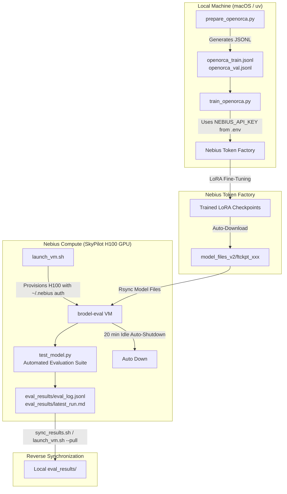

# OpenOrca Fine-Tuning & Ephemeral Evaluation Strategy

This document outlines the architecture, execution pipeline, and hyperparameter search strategy for fine-tuning open-weights LLMs (e.g. `unsloth/gpt-oss-20b-BF16` and `meta-llama/Llama-3.1-8B-Instruct`) on the **OpenOrca** dataset using **Nebius Token Factory** and **Nebius Compute (via SkyPilot)**.

---

## 1. Architecture & Ephemeral Lifecycle



---

## 2. Lessons Learned from Baseline Runs

During the initial baseline test (`eli5-verify-v1`), repetitive token degeneration (`"Sure Sure Sure..."`) was observed. Analysis identified two primary root causes:

1. **Learning Rate & Epoch Overfitting:**
   - The initial run used a high learning rate (`2e-4`) across **10 epochs** on a small dataset (~1,500 QA pairs).
   - For parameter-efficient fine-tuning (LoRA) on larger backbones (20B), this caused severe representation collapse in early layers.
2. **Chat Template Formatting:**
   - The base model requires strict channel token separation (`<|channel|>final<|message|>`) and repetition penalties during inference.

---

## 3. Hyperparameter Hunting Plan

To establish the optimal configuration for instruction following and reasoning fidelity, we will execute a structured hyperparameter sweep:

| Parameter | Baseline (Degraded) | **Run 1 (Target Baseline)** | **Run 2 (High Capacity)** | **Run 3 (Conservative)** |
| :--- | :--- | :--- | :--- | :--- |
| **Dataset** | ELI5 (1.5k) | **SlimOrca (2.5k train / 200 val)** | SlimOrca (5k train / 300 val) | SlimOrca (2.5k train / 200 val) |
| **Learning Rate** | `2e-4` ❌ | **`3e-5`** ✅ | `2e-5` | `1.5e-5` |
| **LoRA Rank ($r$)** | 16 | **16** | 32 | 16 |
| **LoRA Alpha ($\alpha$)** | 32 | **32** (Ratio 2.0) | 64 (Ratio 2.0) | 16 (Ratio 1.0) |
| **Epochs** | 10 ❌ | **3** | 2 | 2 |
| **Batch Size** | 4 | **4** | 8 | 4 |
| **Warmup Ratio** | 0.05 | **0.05** | 0.05 | 0.10 |
| **Weight Decay** | 0.01 | **0.01** | 0.01 | 0.01 |
| **Context Length** | 8192 | **4096** | 4096 | 4096 |
| **Sequence Packing** | True | **True** | True | True |

### Rationale:
- **Learning Rate ($3\times 10^{-5}$):** Keeps the pre-trained weights stable while allowing LoRA matrices to adapt cleanly to OpenOrca reasoning chains.
- **Epoch Count (2–3):** Prevents memorization and catastrophic forgetting on smaller instruction slices.
- **Validation Tracking:** Using `openorca_val.jsonl` provides continuous validation loss metrics to catch overfitting before deploying to GPU VMs.

---

## 4. Execution Playbook

### Step 1: Prepare OpenOrca Dataset
Extract and format a high-quality slice of `Open-Orca/SlimOrca`:
```bash
uv run python prepare_openorca.py --samples 2500 --val-samples 200
```

### Step 2: Launch Fine-Tuning on Nebius Token Factory
Trigger the training job using the Token Factory API key in `.env`:
```bash
# Target Run 1 (Recommended starting point)
uv run python train_openorca.py \
  --train-data openorca_train.jsonl \
  --val-data openorca_val.jsonl \
  --lr 3e-5 \
  --epochs 3 \
  --r 16 \
  --alpha 32 \
  --suffix openorca-lora-v1
```

*Note: Checkpoints will automatically be saved to `model_files_v2/<checkpoint_id>/` upon completion.*

### Step 3: Launch Ephemeral Evaluation VM
Deploy an H100 VM on Nebius Compute using SkyPilot:
```bash
./launch_vm.sh <checkpoint_id>
```
*The script automatically verifies ~/.nebius IAM credentials, forwards HF_TOKEN, deploys the VM, sets a 20-minute autostop, and triggers reverse sync.*

### Step 4: Run Evaluation Benchmark
Inside the VM (or scripted via `test_model.py`):
```bash
# Connect to cluster
sky ssh brodel-eval

# Inside VM:
cd sky_workdir
uv run python test_model.py --model_dir <checkpoint_id>
```

### Step 5: Pull Results Locally
Pull the generated evaluation logs and reports back to your local machine:
```bash
./sync_results.sh
# Results will be available in ./eval_results/latest_run.md and ./eval_results/eval_log.jsonl
```

---

## 5. Ephemeral Evaluation Criteria

Each checkpoint will be evaluated across 4 core axes:

1. **Instruction Fidelity & Formatting:** Does the model follow multi-constraint prompts without dropping instructions?
2. **Chain-of-Thought Coherence:** Does the model produce logical reasoning steps without jumping into repetitive loops?
3. **Repetition & Degeneration Score:** Verify absence of token loops (checked with $N$-gram distinctness).
4. **Base vs. Fine-Tuned Delta:** Compare side-by-side against the unadapted base model (`test_model.py --base_only`).
